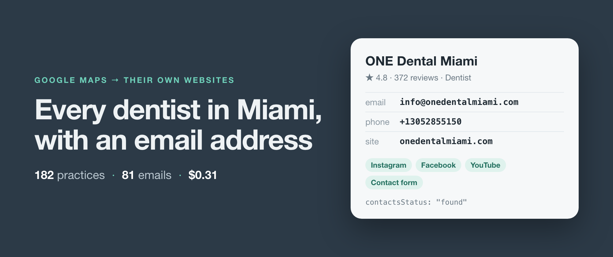
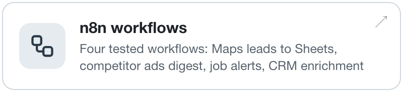
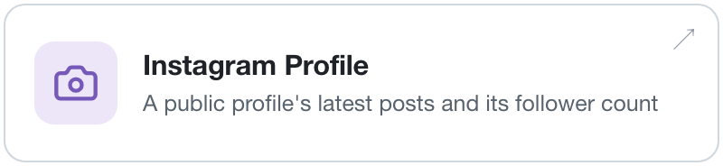
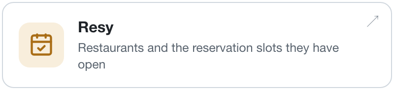

<picture><source media="(prefers-color-scheme: dark)" srcset="header-dark.png"></picture>

I build web scrapers, publish them on Apify, and keep them running when the sites change underneath them. Each one reads a site the way it serves itself to a logged-out visitor and returns one clean row per thing you asked for. When it can't read something, the row says so and says why, rather than handing you an empty file.

The repos here are working examples: the problem, a Node and a Python script, and real output from a real run. The write-ups are on **[simple-actor.github.io](https://simple-actor.github.io)**.

## Latest write-up

**[How to get the email of every dentist in Miami from Google Maps](https://simple-actor.github.io/email-every-dentist-miami-google-maps/)**: 182 practices, 81 email addresses, 31 cents, and where it falls short. Code: [google-maps-email-scraper](https://github.com/simple-actor/google-maps-email-scraper)

## Use them without writing code

<a href="https://github.com/simple-actor/n8n-claude-lead-generation/tree/main/n8n"><picture><source media="(prefers-color-scheme: dark)" srcset="cards/n8n-workflows-dark.png"></picture></a>
<a href="https://github.com/simple-actor/n8n-claude-lead-generation/tree/main/claude"><picture><source media="(prefers-color-scheme: dark)" srcset="cards/claude-guides-dark.png"></picture></a>

## The scrapers

### Leads and local businesses

<a href="https://apify.com/simple.actor/google-maps-leads"><picture><source media="(prefers-color-scheme: dark)" srcset="cards/google-maps-leads-dark.png"></picture></a>
<a href="https://apify.com/simple.actor/google-maps"><picture><source media="(prefers-color-scheme: dark)" srcset="cards/google-maps-dark.png"></picture></a>
<a href="https://apify.com/simple.actor/website-contacts"><picture><source media="(prefers-color-scheme: dark)" srcset="cards/website-contacts-dark.png"></picture></a>
<a href="https://apify.com/simple.actor/business-profile"><picture><source media="(prefers-color-scheme: dark)" srcset="cards/business-profile-dark.png"></picture></a>

### Search and ads

<a href="https://apify.com/simple.actor/google-search"><picture><source media="(prefers-color-scheme: dark)" srcset="cards/google-search-dark.png"></picture></a>
<a href="https://apify.com/simple.actor/google-images"><picture><source media="(prefers-color-scheme: dark)" srcset="cards/google-images-dark.png"></picture></a>
<a href="https://apify.com/simple.actor/google-short-videos"><picture><source media="(prefers-color-scheme: dark)" srcset="cards/google-short-videos-dark.png"></picture></a>
<a href="https://apify.com/simple.actor/google-ads-transparency"><picture><source media="(prefers-color-scheme: dark)" srcset="cards/google-ads-transparency-dark.png"></picture></a>

### Social profiles and jobs

<a href="https://apify.com/simple.actor/facebook-page-posts"><picture><source media="(prefers-color-scheme: dark)" srcset="cards/facebook-page-posts-dark.png"></picture></a>
<a href="https://apify.com/simple.actor/instagram-profile-posts"><picture><source media="(prefers-color-scheme: dark)" srcset="cards/instagram-profile-posts-dark.png"></picture></a>
<a href="https://apify.com/simple.actor/tiktok-profile-posts"><picture><source media="(prefers-color-scheme: dark)" srcset="cards/tiktok-profile-posts-dark.png"></picture></a>
<a href="https://apify.com/simple.actor/x-profile-posts"><picture><source media="(prefers-color-scheme: dark)" srcset="cards/x-profile-posts-dark.png"></picture></a>
<a href="https://apify.com/simple.actor/youtube-channel-videos"><picture><source media="(prefers-color-scheme: dark)" srcset="cards/youtube-channel-videos-dark.png"></picture></a>
<a href="https://apify.com/simple.actor/linkedin-company-posts"><picture><source media="(prefers-color-scheme: dark)" srcset="cards/linkedin-company-posts-dark.png"></picture></a>
<a href="https://apify.com/simple.actor/linkedin-jobs"><picture><source media="(prefers-color-scheme: dark)" srcset="cards/linkedin-jobs-dark.png"></picture></a>

### Travel, restaurants and the open web

<a href="https://apify.com/simple.actor/booking-hotels"><picture><source media="(prefers-color-scheme: dark)" srcset="cards/booking-hotels-dark.png"></picture></a>
<a href="https://apify.com/simple.actor/opentable-restaurants"><picture><source media="(prefers-color-scheme: dark)" srcset="cards/opentable-restaurants-dark.png"></picture></a>
<a href="https://apify.com/simple.actor/resy-availability"><picture><source media="(prefers-color-scheme: dark)" srcset="cards/resy-availability-dark.png"></picture></a>
<a href="https://apify.com/simple.actor/page-text-reader"><picture><source media="(prefers-color-scheme: dark)" srcset="cards/page-text-reader-dark.png"></picture></a>

All of them, with prices: **[apify.com/simple.actor](https://apify.com/simple.actor)**
